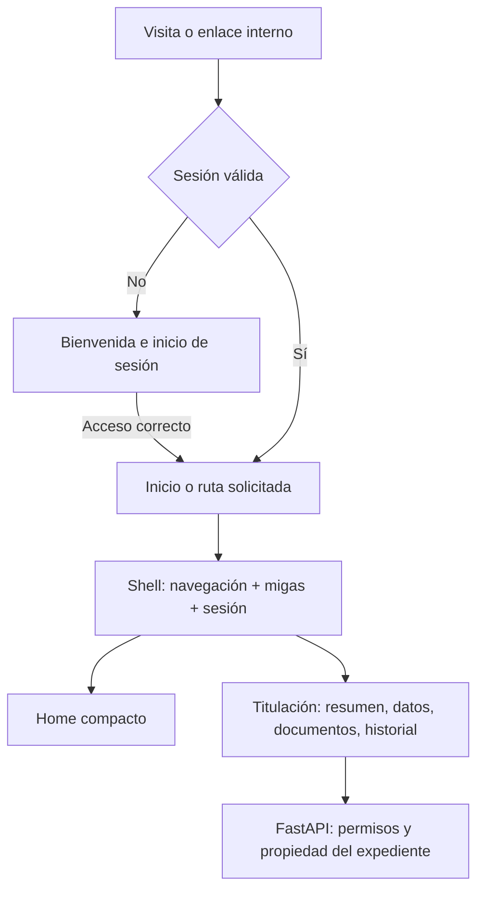

# Arquitectura de interfaz: acceso y espacio privado

12 de octubre de 2026. CR-003 separó bienvenida y home privado. CR-004, solicitado por el líder, sustituye la navegación lateral y rediseña acceso y trabajo a partir del [estudio detallado de Laravel](ESTUDIO-LARAVEL.md). El stack permanece React/JavaScript, FastAPI/Python y PostgreSQL. Laravel es una referencia visual.

## Referencias verificadas y decisiones

| Fuente primaria                                                                                             | Qué se toma                                                                    | Aplicación en la UT                                                                            |
| ----------------------------------------------------------------------------------------------------------- | ------------------------------------------------------------------------------ | ---------------------------------------------------------------------------------------------- |
| [Laravel, layouts de starter kits](https://laravel.com/framework/docs/13.x/starter-kits)                    | Distingue layouts de aplicación (sidebar/header) de acceso (simple/card/split) | Shell con espacio autenticado y bienvenida pública separados; una navegación global compartida |
| [Primer de GitHub, navegación](https://primer.style/product/ui-patterns/navigation/)                        | Ubicación, regreso y continuidad entre contextos                               | Accesos directos, navegación del módulo y jerarquía estable                                    |
| [Primer, breadcrumbs](https://primer.style/product/components/breadcrumbs/)                                 | Muestra ancestros de la página, no una lista de clics previos                  | Inicio → Titulación electrónica → Documentos; folio real al consultar un expediente autorizado |
| [W3C, patrón de migas de pan](https://www.w3.org/WAI/ARIA/apg/patterns/breadcrumb/)                         | Landmark nav identificado y página actual                                      | nav con aria-label, lista ordenada, enlaces a ancestros y aria-current=page                    |
| [BBVA México, Banca por Internet](https://www.bbva.mx/personas/servicios-digitales/banca-por-internet.html) | La presentación pública ofrece un acceso diferenciado al servicio de clientes  | La raíz del sistema exige sesión; la bienvenida no muestra expedientes ni simula operaciones   |
| [Samsung, motion basics](https://developer.samsung.com/one-ui/motion/basic.html)                            | Movimiento coherente con contexto y comprensión de relaciones                  | Entrada breve en la ilustración y respuesta de controles; las tareas no esperan una animación  |

Estas referencias no definen una arquitectura visual única ni prueban usabilidad para esta universidad. No se inspeccionaron cuentas privadas de bancos ni se copiaron sus pantallas, logos, textos o certificaciones de seguridad. La adaptación es una decisión del proyecto.

## Dos experiencias con una identidad

**Bienvenida y acceso (`/acceso`).** Marca institucional temporal, titular amplio, ilustración SVG propia por capas y formulario abierto. Los planos representan datos, documentos y seguimiento; no son documentos oficiales. Usa la paleta propuesta. La entrada termina a 1.7 s; puede repetirse con un botón. Sin bucles, sonido o bloqueo del formulario. Con prefers-reduced-motion aparece estática. En móvil el formulario queda debajo del dibujo, en una columna.

**Home privado (`/`).** Exige sesión. Solo contiene saludo breve, módulo habilitado y accesos directos por rol. Se retiran el directorio promocional, la guía de pasos, los requisitos extensos y los bloques de atención del home. Esa información permanece en Ayuda. No se añaden módulos ficticios ni métricas vacías para llenar espacio.

**Trabajo dentro del sistema.** Encabezado global horizontal con sesión; migas en una fila debajo. Sin sidebar. Por debajo de 960 px, menú nativo dialog con Escape, foco contenido y devolución al disparador. Titulación conserva pestañas horizontales, junto a su identidad en escritorio y debajo en móvil. Los encabezados se desplazan con el documento. Un equipo futuro reutiliza este marco; no crea otro encabezado o login.

La protección de rutas del cliente solo organiza el flujo. Las autorizaciones reales siguen en FastAPI. No se agregan secretos, datos de expedientes o tokens a localStorage.

## Contratos para los equipos

- `shared/navigation.js`: registro de módulos habilitados, accesos directos y jerarquía. Cada entrada declara id, path, nombre, área, roles, páginas y nombre de entidad. No registrar funciones que aún no existen.
- `src/app/Navigation.jsx`: proveedor de contexto y componente Breadcrumbs. El contexto recibe el folio de la respuesta autorizada mediante useBreadcrumbEntity; nunca lo deduce del ID de la URL. En 404 o carga muestra “Expediente”, sin inventar folios.
- `src/app/Shell.jsx`: marco público/privado, sesión, navegación superior y diálogo móvil. Cada módulo aporta contenido y su navegación local.
- `src/styles/app.css`: componentes de trabajo, formularios, tablas y estados. `src/styles/layout.css`: marcos, navegación, bienvenida y home. Ambos usan tokens.css; no definir paletas independientes.
- `src/modules/auth/WelcomeArt.jsx`: ilustración vectorial y animación de bienvenida. No introduce dependencias, peticiones a proveedores de imágenes ni fuentes externas.

Agregar un módulo requiere aprobar requisitos, implementar rutas protegidas/API/permisos y registrar su navegación. La visibilidad por rol no sustituye autorización. Un cambio de roles exige revisión del núcleo y del modelo.

## Criterios de aceptación

Sin sesión, la raíz y enlaces privados llevan al acceso. Una entrada normal termina en Inicio; un enlace privado conserva su destino al autenticarse. Cerrar sesión regresa al acceso. Cada vista tiene migas coherentes con sus ancestros y una página actual identificada. El folio aparece únicamente después de obtener el expediente autorizado. En móvil, las migas envuelven líneas y las pestañas se desplazan en su contenedor. El menú responde a Escape y devuelve el foco.

Comprobar 320/390/768/1440 px sin desbordamiento global. Revisar contraste, teclado, errores y foco; la imagen no puede impedir completar el acceso. No se afirma una conformidad WCAG completa ni se sustituye la aceptación con usuarios institucionales.

El cierre de sesión carga un documento nuevo para limpiar el estado de interfaz y el destino de la cuenta anterior. Un enlace privado solicitado posteriormente conserva su propio destino. Las vistas de perfil/documentos/historial del egresado redirigen al personal a la bandeja; no cambian sus permisos en el servidor.

## Actualización de identidad · CR-005

Brand se extrae a src/shared/Brand.jsx y sirve PNG oficial + azor sin duplicación por módulo. AccountMenu reemplaza nombre/rol/salida estáticos por un disparador de perfil; la lista ofrece edición del nombre visible y logout. /cuenta es una ruta protegida común con migas propias. La bienvenida conserva la imagen lateral y utiliza columna de acceso con Google/correo/teléfono. Contrato de autenticación y configuración en ACCESO-INSTITUCIONAL.md.
