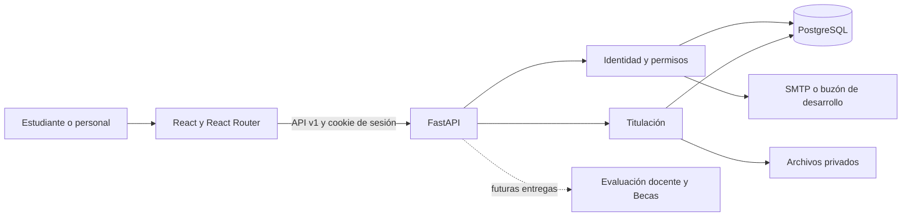

# Arquitectura común

La decisión inicial es un **monolito modular**: una aplicación React y una API FastAPI, con separación por dominio. Así los mini equipos pueden trabajar en paralelo conservando una identidad, datos coherentes y un despliegue sencillo. No se requieren microservicios para integrar estos módulos.



## Carpetas y propietarios

```text
src/
  app/                  Router, AuthProvider y Shell; responsabilidad del líder
  shared/               API, formularios, badges, diálogos y estados comunes
  styles/               Tokens y estilos globales
  modules/
    home/               Inicio y ayuda
    auth/               Acceso y recuperación
    titulacion/         Vistas del módulo
backend/
  app/
    core/               Configuración, DB, identidad y sesiones compartidas
    modules/
      titulacion/       Modelos, dominio y router propios
    main.py             Registro de routers y middleware
  migrations/           Versiones Alembic revisadas por el líder
  tests/                Pruebas de API y seguridad
shared/titulacion.js     Catálogo del cliente verificado contra dominio Python
docs/                   Especificaciones, diseño y acuerdos
```

## Contrato entre módulos

El módulo declara su router bajo `/api/v1/<nombre>` y sus vistas bajo `/<nombre>`. Importa `current_user` y `get_db`; no crea un login, tabla de usuarios o motor de base separado. Las entidades propias tienen prefijo de tabla para evitar colisiones. Las notificaciones se crean en el servidor con el ID del destinatario autorizado.

No modificar internamente las tablas de otro módulo. Si Becas necesita datos académicos, acordar primero el contrato de lectura del núcleo y su autorización. No reutilizar la tabla de expedientes para solicitudes de becas ni mezclar comentarios docentes con datos de titulación.

Agregar un rol futuro exige un cambio revisado: catálogo, restricciones SQL, autorización, diseño de acceso y pruebas. “Administrador” no significa automáticamente acceso a todos los datos de evaluación o a validaciones exclusivas de Tesorería/Vinculación.

## Persistencia e integridad

SQLAlchemy 2 usa el dialecto `postgresql+psycopg`. Cambiar la base requiere evaluar restricciones parciales, bloqueo de filas, índices, tipos y estrategia de migración; no basta con cambiar una URL. SQLite solo es una facilidad desechable de pruebas, no el modo de operación publicado.

Entidades actuales: usuarios, sesiones, recuperación de acceso, solicitudes, documentos, eventos y notificaciones. Las relaciones usan claves foráneas. Índices únicos protegen correo, folio, documento por tipo y expediente no cancelado por persona. `SELECT ... FOR UPDATE` serializa cambios del expediente; `version` rechaza confirmaciones sobre un estado viejo.

Al enviar, los datos del egresado se conservan en una instantánea del expediente. Los datos personales se bloquean durante revisión. Un cambio de estado, su evento y su notificación se guardan en la misma transacción. Los estados terminales no permiten nuevas transiciones.

Los archivos se guardan fuera del frontend, con nombres UUID y descarga autenticada. La base contiene metadata, nunca una ruta proporcionada por el usuario. Reemplazar un archivo preserva el documento previo si falla la transacción, y elimina el archivo anterior después de confirmar. Un fallo de disco después del commit puede dejar un archivo huérfano: antes de producción se requiere conciliación periódica, cuotas y control operativo de almacenamiento.

## Seguridad implementada

Contraseñas con scrypt N=131072, r=8, p=1 y sal aleatoria; comparación de tiempo constante. Tokens de sesión/recuperación aleatorios almacenados por SHA-256; no se almacenan contraseñas reversibles ni tokens en localStorage. Cookie HttpOnly y SameSite Strict; Secure obligatorio en producción. Mutaciones autenticadas requieren CSRF. Se valida Origin cuando viene informado y se rechazan peticiones cross-site.

El backend aplica permisos y propiedad de registros. Se comprueba extensión, firma inicial del archivo y tamaño. La descarga fuerza attachment y nosniff. CSV neutraliza valores que podrían convertirse en fórmulas. El navegador renderiza texto mediante React, sin HTML de usuarios.

## Límites y decisiones pendientes

El límite de intentos es local al proceso; para varios workers se necesita un límite compartido o gateway. La validación de encabezado del archivo no es un antivirus ni análisis integral de PDF/JPG. No hay SSO, MFA, cuotas globales de almacenamiento o entrega oficial de XML. El historial conserva actor/fecha/acción pero no es un registro inmutable frente a un administrador de base.

La UI administra una lista de hasta 500 solicitudes; antes de mayores volúmenes se requiere paginación y búsqueda del servidor. Los reportes completos, catálogos de carreras/modalidades, correcciones excepcionales y operación con múltiples campus necesitan requisitos aprobados.

Decisiones registradas: ADR-001 monolito modular; ADR-002 React/JS y FastAPI/Python por indicación del líder; ADR-003 PostgreSQL y migraciones Alembic; ADR-004 CSS central con tokens; ADR-005 emisión oficial del título como integración externa pendiente. Cambiarlas exige impacto y aprobación según docs/CASCADA.md.
