# Galería de la aplicación

Capturas de validación local, 13 de octubre de 2026. Todas las cuentas, teléfonos, nombres y expedientes mostrados son ficticios; no utilizar capturas de operaciones institucionales reales en Git. Google está implementado pero pendiente de configuración OAuth en este entorno.

## Acceso institucional

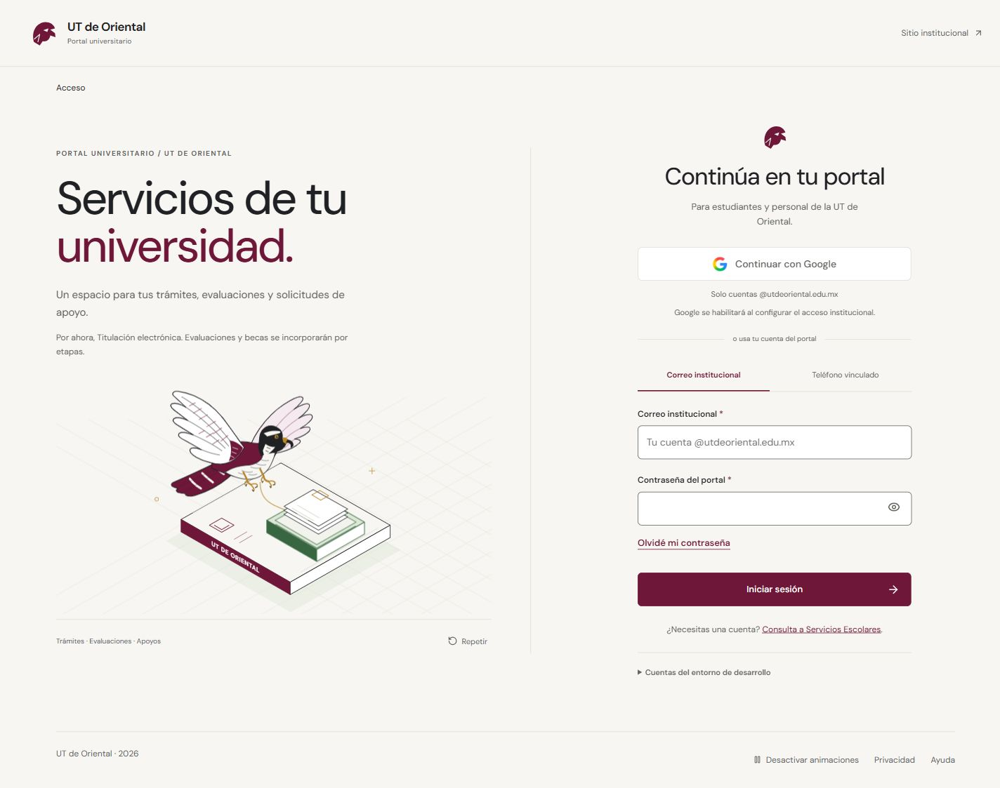

## Inicio privado

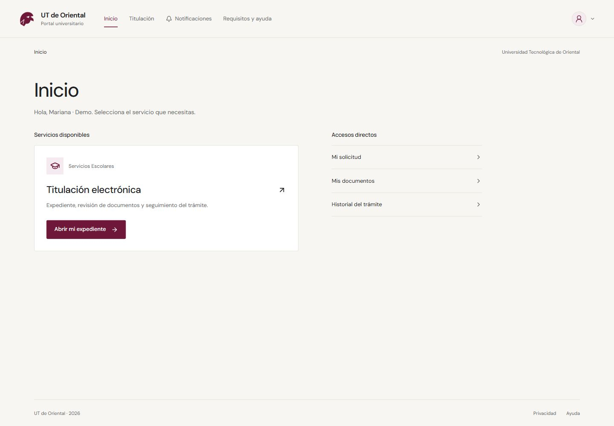

## Menú de cuenta

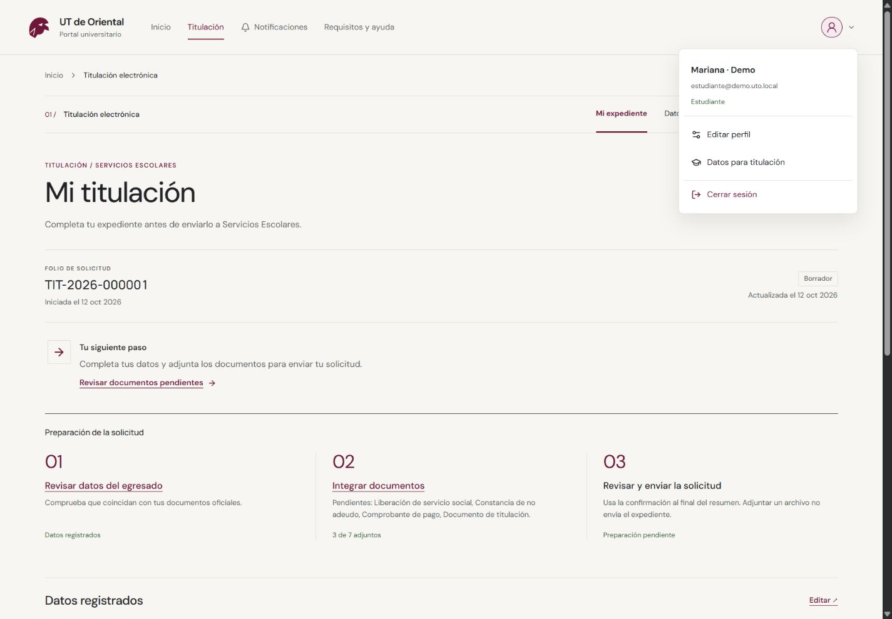

## Perfil

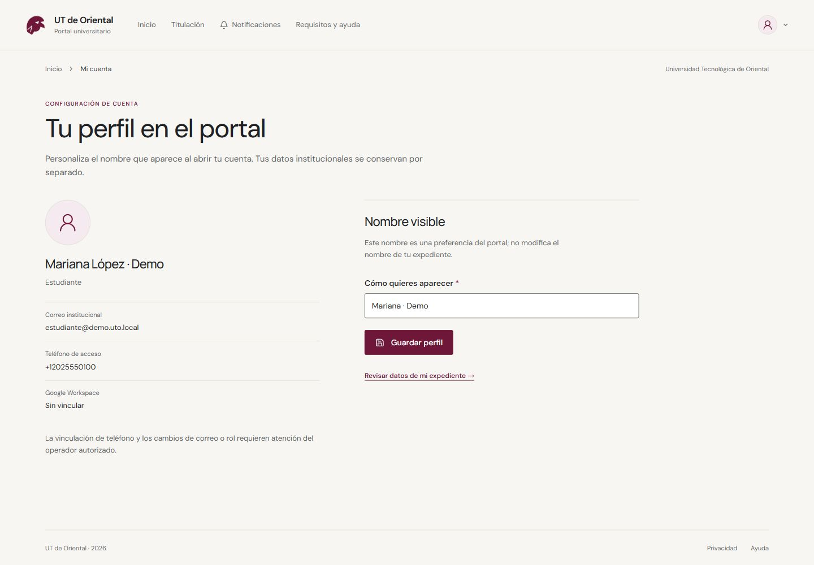

## Adaptación móvil

La preferencia vigente es CR-006: animaciones activadas inicialmente, con control en el footer. Las capturas son estáticas. Acceso y acceso móvil muestran CR-008/009: bienvenida común, anatomía del azor revisada y rótulo centrado, con aclaración de servicios disponibles/futuros. Inicio, menú y perfil corresponden a CR-005. Los archivos de este directorio son evidencia ficticia seleccionada para publicar. Pruebas adicionales y capturas sin revisar permanecen en output/, excluido de Git.

## Revisión integral · CR-007

Bandeja con etiquetas persistentes, conteo de resultados y filtros. Cuenta administradora ficticia; no obtiene permisos de Tesorería o Vinculación.

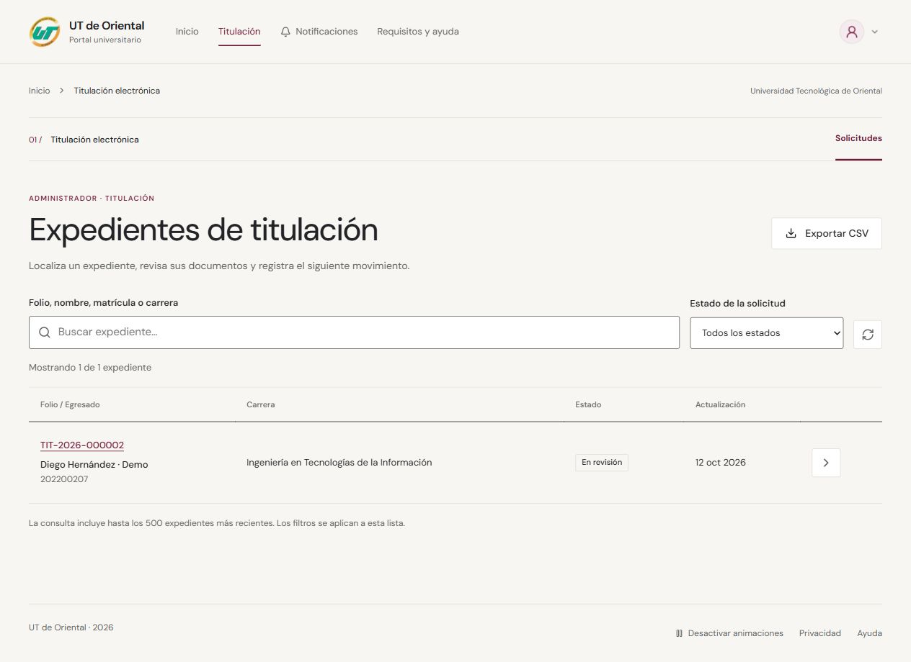

Resumen del estudiante, con tareas de preparación y menos instrucciones repetidas.

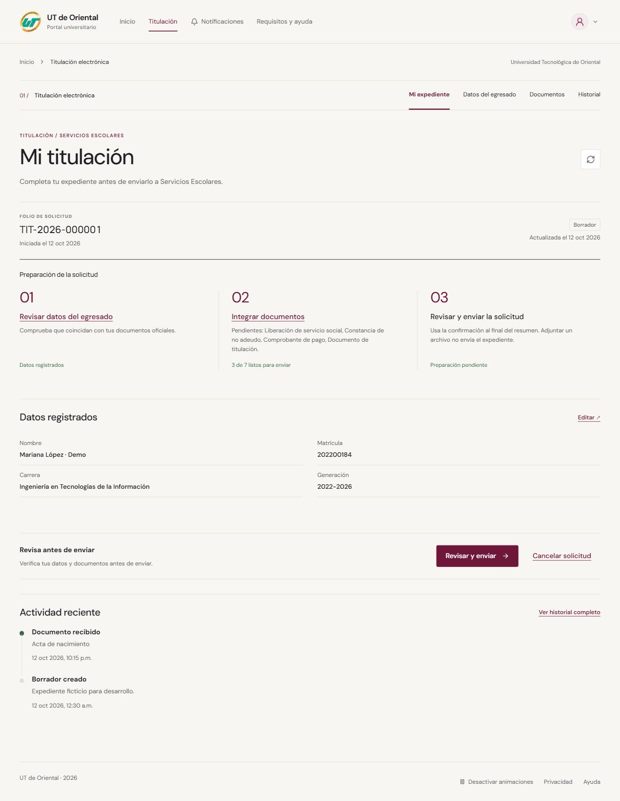

## Integración de módulos · CR-010

24 de octubre de 2026. Capturas locales con cuentas y registros ficticios marcados como Demo/Ejemplo. Se revisan antes de preparar el índice. No muestran credenciales, expedientes reales ni configuración privada.

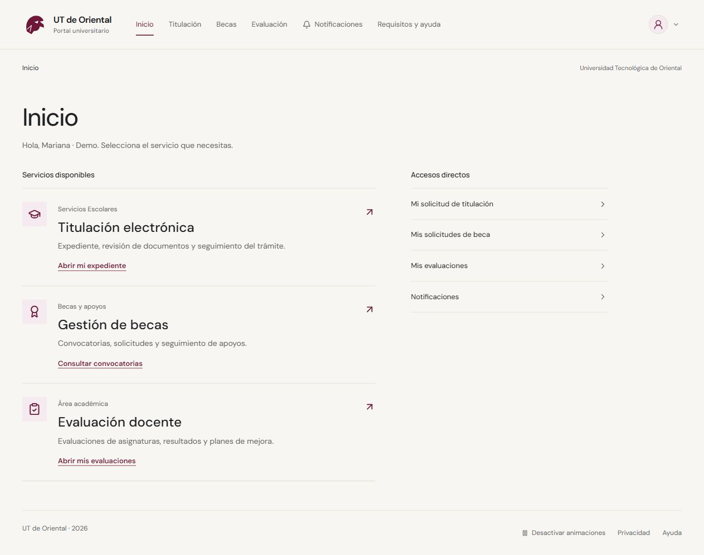

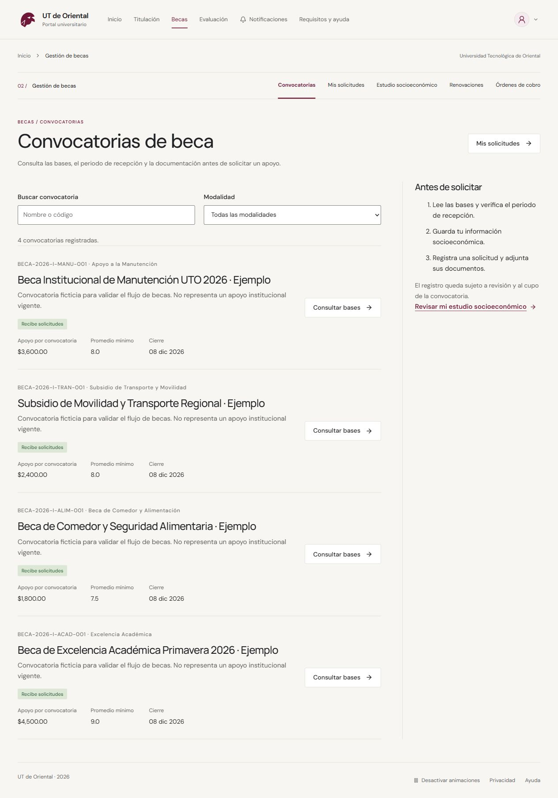

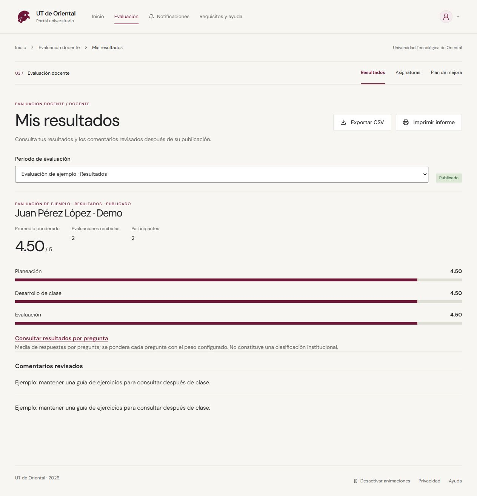

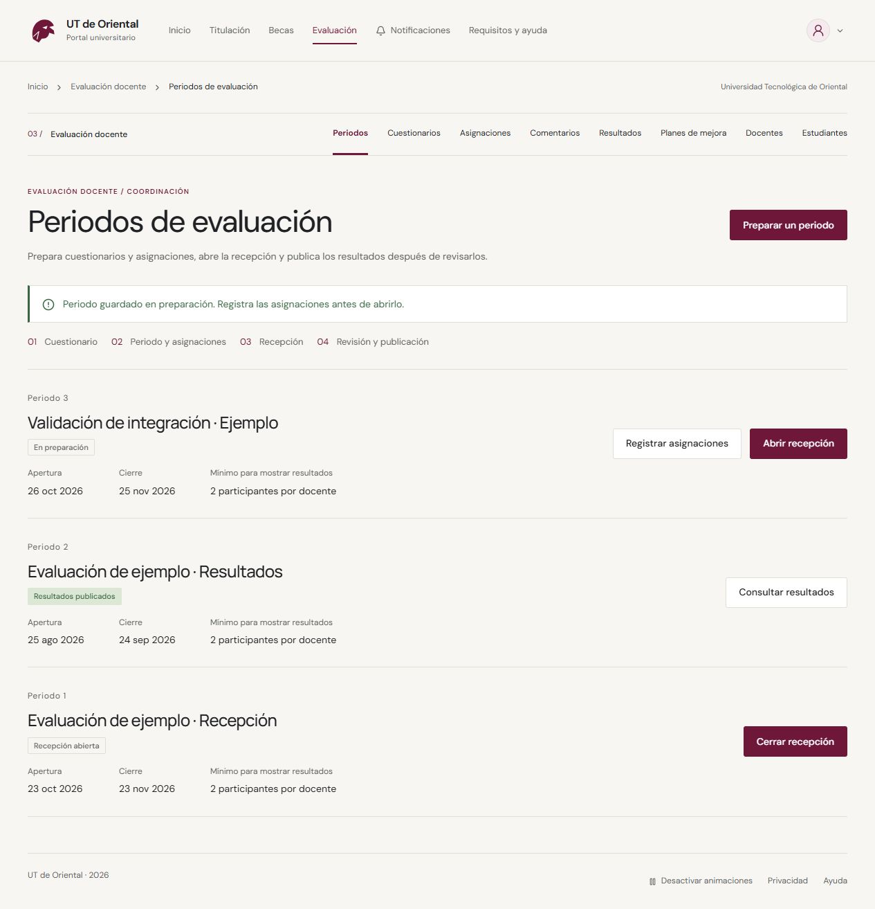

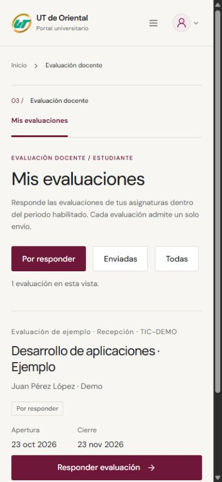

Los PNG anteriores se conservan como evidencia histórica de CR-005/007/009. Los JPG de esta sección corresponden a la integración actual. No representan una aprobación institucional ni operación con datos reales.

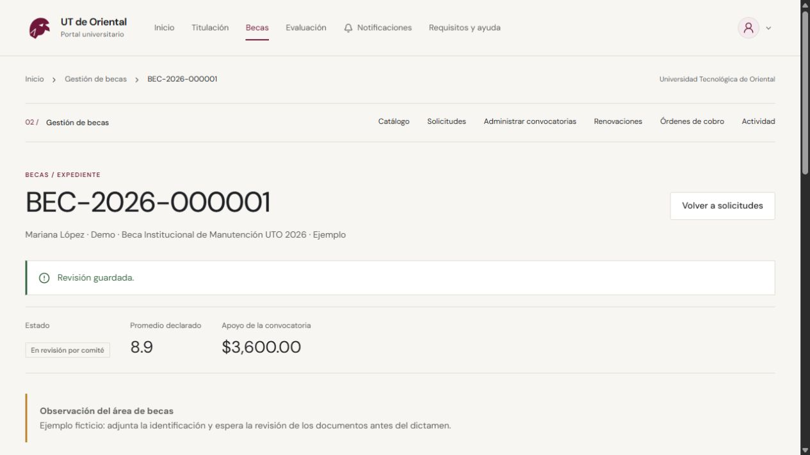
